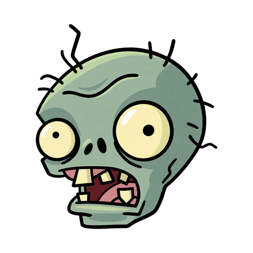

<p align="center"></p>

# Agent Peeps

[agentpeeps.space](https://agentpeeps.space) · npm: `agentpeeps` (the old `agent-presence` command still works; settings stay in `~/.agent-presence`)

Small stickers that float over your screen and show what your AI coding agents are doing, live.
One sticker per Claude Code, Codex, Copilot or Antigravity session, a smaller one for each subagent (helper), and a tiny icon for what it's doing: reading, writing, running, done, or needs you. Hover for the file it's on.

- Works with Claude Code (CLI, desktop app, IDE), Codex, GitHub Copilot (VS Code agent mode and Copilot CLI) and Antigravity, because it listens to the agents' own hooks, not to an editor.
- Floats above everything, VS Code included. Clicks pass straight through except on the stickers.
- Local only: no server, no account, no network.

## Install

```bash
npx agentpeeps init    # adds hooks for every supported agent it finds (backups are kept)
```

The stickers appear on your next agent session (or start them now with `npx agentpeeps overlay`).
Because npx runs from a cache it may clear, `init` first installs a permanent copy into `~/.agent-presence/app` and points the hooks there. Run it again any time to update.

Prefer a global install? Same result:

```bash
npm i -g agentpeeps
agentpeeps init
agentpeeps overlay     # start the stickers (also auto-starts on your next agent session)
```

| Agent | Where `init` writes |
|---|---|
| Claude Code | `~/.claude/settings.json` |
| Codex | `~/.codex/hooks.json` |
| Copilot | `~/.copilot/hooks/agent-presence.json` (VS Code agent mode and Copilot CLI both read it) |
| Antigravity | `~/.gemini/config/hooks.json`, under the `agent-presence` key |

Pick some with `agentpeeps init copilot antigravity`.

Codex asks you to trust new hooks once: open `/hooks` in Codex and approve the Agent Peeps entries.
Copilot and Antigravity load hooks at startup, so restart them after `init`. Their hooks can't run in the background, so Agent Peeps only listens to events that can't hold up or block the agent: a tool call shows up when it finishes, not when it starts.

### Or as plugins (hooks + a customize-my-sticker skill; the overlay still comes from npm)

**Claude Code**

```
/plugin marketplace add watermelon588/agent-presence
/plugin install agent-presence@agent-presence
```

**Codex** (CLI or desktop app)

```bash
codex plugin marketplace add watermelon588/agent-presence
```

Then open `/plugins` in Codex, install **Agent Peeps**, and approve its hooks when Codex asks (Codex never trusts plugin hooks automatically). Plugins with hooks can't be listed in OpenAI's public plugin directory, so this GitHub marketplace is the install path.

Use either the plugin or `agentpeeps init` for an agent, not both, or every event is recorded twice.

### In VS Code (also Cursor, Windsurf, Antigravity)

The [`vscode/`](vscode/) extension reads the same event log and adds:

- **Explorer badges**: solid initials in each agent's color (🅒 Claude, 🅧 Codex, 🅟 Copilot, 🅐 Antigravity; helpers show their type's initial, e.g. 🅔 Explore), with folders lighting up around active files
- an **Agents** view in the Explorer with each agent's sticker, its subagents and the files it touched

Until it's on the Marketplace / Open VSX: `code --install-extension vscode/agent-presence-vscode-0.1.0.vsix`

## Commands

| Command | What it does |
|---|---|
| `agentpeeps init [agent...]` | Install hooks: `claude`, `codex`, `copilot`, `antigravity` (default: every one found) |
| `agentpeeps uninstall [agent...]` | Remove only our hooks |
| `agentpeeps overlay` / `--quit` | Start / stop the floating stickers |
| `agentpeeps control [agent]` | Open the control room (optionally straight on one agent's stickers) |
| `agentpeeps packs` | List sticker packs |
| `agentpeeps set <target> <pack|image|default>` | Give an agent, a model (`model:opus`), helpers or a helper type its stickers |
| `agentpeeps watch` | Live view in the terminal: every agent, its helpers and the files each one touched |
| `agentpeeps emit <agent> [event]` | Used by the hooks: reads hook JSON on stdin |

### Control room (no config editing, no agent, no tokens)

Click the **tray icon** (next to the clock) or run `agentpeeps control`. One window holds everything:

- **Settings**: show or hide the stickers, size (small / medium / large), when to show an agent (while it works / only when it needs you / always), details (on hover / always), which agents to show, start automatically, reset positions.
- **Stickers**, set once per target: each agent, each agent's helpers, every helper, or one helper type (Explore, test-writer...). Pick several and each session or helper gets its own from your set.

On the stickers themselves:

- **Hover** for who it is, what it's doing and its recent files (click one to show it in its folder).
- **Drag** a sticker to put that agent anywhere; each agent remembers its spot.
- **Right-click** to change or hide just that one, hide everything for 30 minutes, or quit.
- `Ctrl+Alt+Shift+A` shows or hides everything.

By default the stickers are small, show only a line icon, and disappear a few seconds after an agent finishes. Until you pick stickers, each agent is a disc in its color with its letter (C Claude, X Codex, P Copilot, A Antigravity). Helpers sit in a dashed pod in their parent's color, with the parent's letter on the corner.

## Your own stickers

### Packs, from the terminal

15 free packs come built in (capybaras, cats, seals-and-sea-lions, fruit-cats, critters and more). Your own pack is a folder of images in `~/.agent-presence/stickers/<pack name>/`. Point any agent, model or helper at one:

```bash
agentpeeps packs                       # list your packs
agentpeeps set claude capybaras        # every Claude session gets a capybara
agentpeeps set codex cats
agentpeeps set model:opus capybaras    # sessions on a model containing "opus"
agentpeeps set model:fable cats
agentpeeps set helpers fruit-cats      # every subagent
agentpeeps set claude-helpers critters # only Claude's subagents
agentpeeps set Explore detective.png   # one subagent type, one image
agentpeeps set claude default          # back to the default disc
```

A session uses its model rule first (the longest match wins), then its agent. A helper uses its type, then its agent's helpers, then every helper. Images added to a pack later are picked up automatically. Claude Code and Antigravity report the model; for agents that don't, model rules simply don't apply.

### Or click

Drop images into `~/.agent-presence/stickers/` (subfolders become groups) and pick them in the control room, or use **Add from my computer…** there. Any PNG, GIF (animated works), SVG, WebP or JPEG; square, about 256 px, looks best.

The control room writes `~/.agent-presence/config.json`, which you (or an agent) can also edit by hand; the overlay applies changes live:

```json
{
  "avatars": {
    "claude": "pack:dinosaurs",
    "model:opus": ["~/stickers/fox.gif", "~/stickers/owl.png"],
    "codex": "~/stickers/robot.png",
    "subagent": "~/stickers/sprout.svg",
    "Explore": "~/stickers/detective.png",
    "test-writer": "~/stickers/bee.png"
  },
  "names": { "claude": "Foxy" },
  "size": "small",
  "show": "working",
  "details": "hover",
  "agents": { "copilot": false },
  "autostart": true
}
```

Sticker keys: an agent (`claude`, `codex`, `copilot`, `antigravity`), `<agent>-subagent` for that agent's helpers, `subagent` for every helper, or a helper type (`Explore`, `test-writer`, anything you named). A helper uses its type first, then its agent's helpers, then every helper. A list gives each session (or helper) one of its images.

## How it works

```
Claude Code hooks ─┐
Codex hooks ───────┤
Copilot hooks ─────┼─ agentpeeps emit ─→ ~/.agent-presence/events.jsonl ─→ overlay (Electron) / watch (terminal) / VS Code
Antigravity hooks ─┘
```

Every hook appends one JSON line (agent, session, subagent id/type, state, file). The emitter never blocks or fails the agent: it always exits 0, swallows errors (set `AGENT_PRESENCE_DEBUG=1` to see them), runs async where the agent allows it, and never registers a hook whose output decides permissions.

States: `idle`, `thinking`, `reading`, `writing`, `running`, `delegating`, `browsing`, `waiting` (needs your permission), `done`.

## Develop

```bash
npm install
node node_modules/electron/install.js   # fetch the Electron binary once
npm test                                 # parser + installer checks
npm run overlay                          # terminal 1
npm run demo                             # terminal 2: plays fake Claude, Codex, Copilot and Antigravity sessions
```

`AGENT_PRESENCE_HOME=<dir>` points everything at a scratch folder. `AGENT_PRESENCE_SNAPSHOT=out.png` makes the overlay save a picture of the dock and quit.

## Roadmap

- Publish the VS Code extension to the Marketplace and Open VSX (Cursor, Windsurf and Antigravity install from Open VSX)
- OpenCode, DeepSeek Harness hooks
- Copilot / Antigravity: show tool calls as they start, if they get a non-blocking pre-tool hook
- Move the Codex manifest to the newer root `plugin.json` (`extensions.com.openai`) once Codex versions without it are gone
- Sticker packs

MIT
