# The control room

One window for everything Agent Peeps does: live sessions, how the stickers look and behave, speech bubbles, keyboard shortcuts and which sticker each agent gets. No config editing, no agent, no tokens.

**Open it** with `Ctrl+Alt+Shift+C` (`⌘⌥⇧C` on macOS), the **tray icon** next to the clock, or:

```bash
agentpeeps control
```

It loads in the background when the overlay starts, so it opens instantly. Closing it only hides it.

Inside the window: `1`–`4` switch pages, `?` opens the shortcuts page, `Esc` goes back to Overview, `/` adds a model rule and `Ctrl+W` closes it.

- [Overview](#overview)
- [Display](#display)
- [Speech bubbles](#speech-bubbles)
- [Keyboard shortcuts](#keyboard-shortcuts)
- [Stickers](#stickers)
- [On the stickers](#on-the-stickers)
- [Settings file](#settings-file)
- [Troubleshooting](#troubleshooting)

## Overview

Every agent session on this machine, live from its hooks.

<p align="center">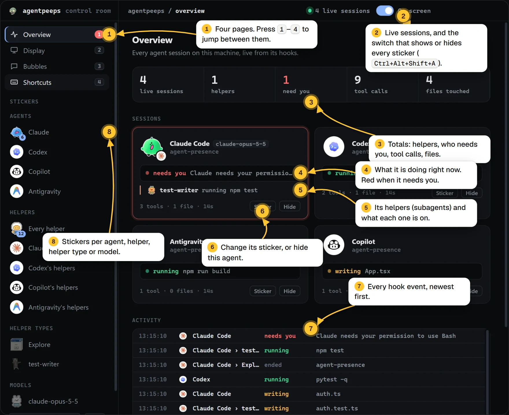</p>

1. **Pages.** Overview, Display, Bubbles, Shortcuts. Press `1`–`4` to jump between them.
2. **Live sessions** and the switch that shows or hides every sticker (`Ctrl+Alt+Shift+A`).
3. **Totals:** live sessions, helpers, how many need you, tool calls and files touched.
4. **What each session is doing right now.** It turns red when the agent is waiting on you (a permission prompt or a question).
5. **Its helpers** (subagents) and what each one is on.
6. **Sticker** jumps to that agent's sticker page. **Hide** hides just that agent.
7. **Activity:** every hook event, newest first.
8. **Sticker targets:** one sticker set per agent, per agent's helpers, every helper, a helper type (Explore, test-writer…) or a model.

## Display

How the stickers sit on your screen. Changes apply right away.

<p align="center">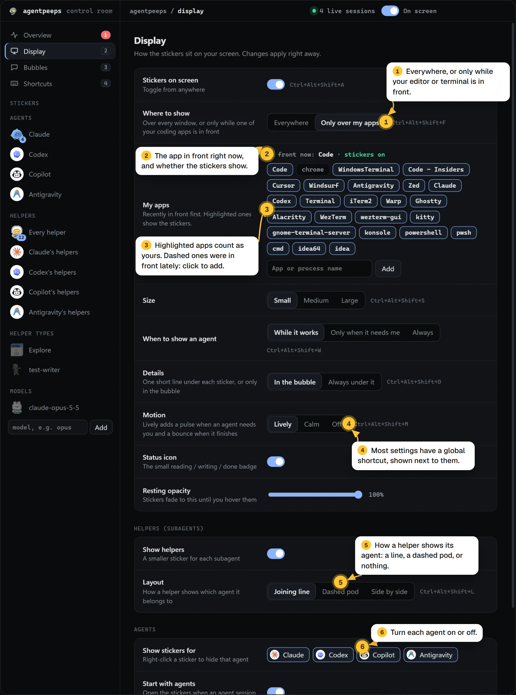</p>

1. **Where to show.** *Everywhere*, or **Only over my apps**: the stickers show only while your editor or terminal is the window in front, and hide when you switch to a browser, a game or a call.
2. **In front now** shows the app that is in front and whether the stickers are showing over it.
3. **My apps.** Highlighted apps count as yours. Apps shown dashed were in front recently: click one to add it, or type a process name. VS Code, Cursor, Windsurf, Antigravity, Zed, the Claude and Codex apps and the common terminals are in the list already.
4. **Shortcut hints.** Most settings have a global shortcut, shown next to them.
5. **Helper layout:** how a helper shows which agent it belongs to.
6. **Agents:** turn the stickers on or off per agent. Right-clicking a sticker does the same for one agent.

The rest of the page: **size** (small, medium, large), **when to show an agent** (while it works, only when it needs you, or always), **details** (in the bubble, or a short line always under the sticker), **motion**, the **status icon**, **resting opacity** (stickers fade to this until you hover them), **show helpers**, and **start with agents** (open the overlay when an agent session starts).

### Helper layout

| Joining line (default) | Dashed pod | Side by side |
|---|---|---|
|  |  |  |
| A thin line in the agent's color, with a dot where it meets the agent. | A dashed outline around the helpers. | Nothing between them. |

### Motion

Every sticker moves with what it's doing: it sways while thinking, tilts while reading, wiggles while writing and hops while running a command.

- **Lively** (default) adds a ring that pulses around a sticker that needs you, a small bump on each new step, a bounce when it finishes, and a blinking status dot.
- **Calm** keeps only the slow loops above.
- **Off:** nothing moves.

## Speech bubbles

The card that shows what an agent is doing. Hover a sticker to see it, click the sticker to pin it open, or peek at every bubble with `Ctrl+Alt+Shift+P`.

<p align="center">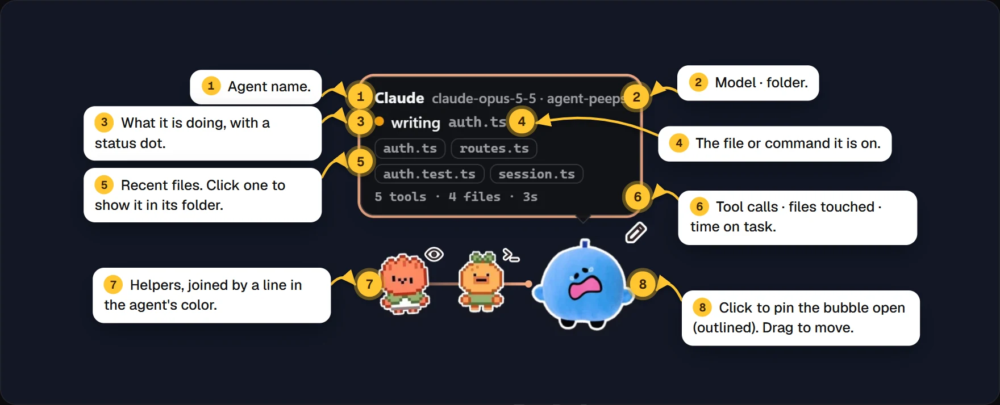</p>

1. **Agent name.**
2. **Model · folder.**
3. **What it is doing**, with a status dot.
4. **The file or command** it is on.
5. **Recent files.** Click one to show it in its folder.
6. **Tool calls · files touched · time on task.**
7. **Helpers**, joined by a line in the agent's color.
8. **The sticker.** Click it to pin the bubble open (the pinned bubble gets an outline). Drag it to move the agent.

The Bubbles page sets all of it, with a live preview on a dark and a light desktop:

<p align="center">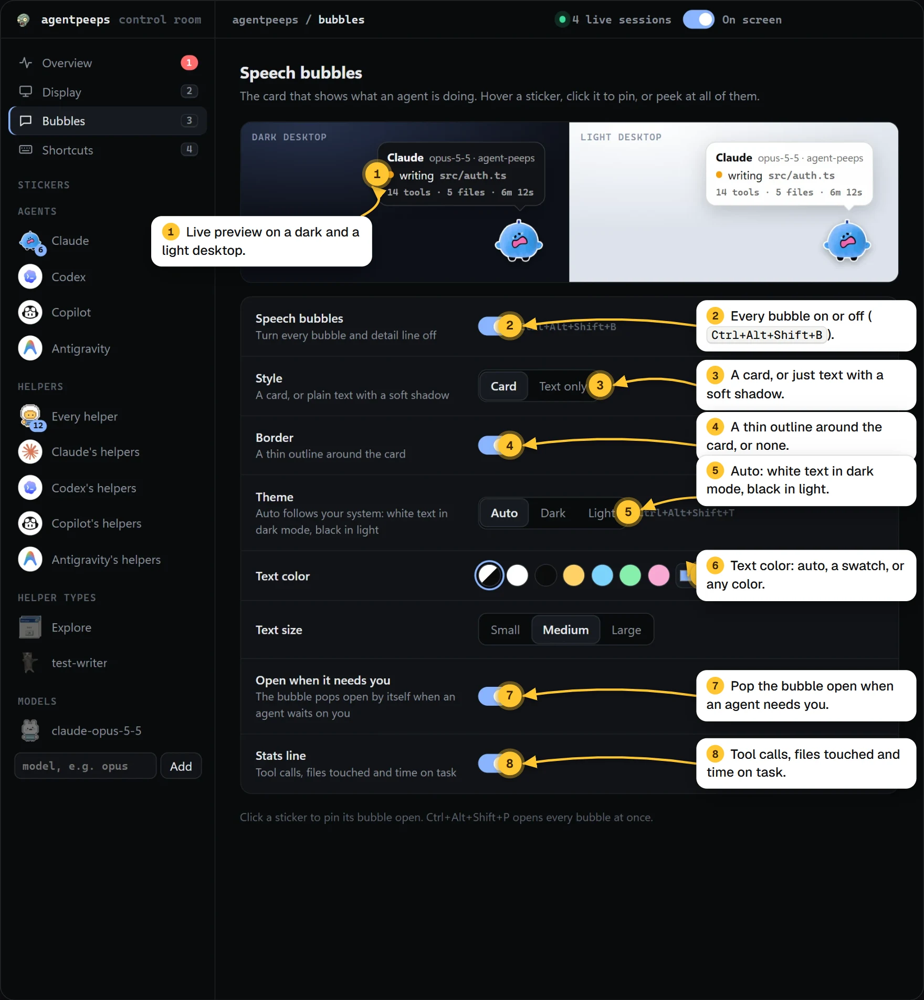</p>

1. **Live preview** on a dark and a light desktop.
2. **Speech bubbles** on or off, everywhere (`Ctrl+Alt+Shift+B`). Off also hides the detail line.
3. **Style:** a card, or just text with a soft shadow.
4. **Border:** a thin outline around the card, or none.
5. **Theme:** *Auto* follows your system, white text in dark mode and black in light. Or force dark or light (`Ctrl+Alt+Shift+T` cycles them).
6. **Text color:** auto, a swatch, or any color.
7. **Open when it needs you:** the bubble pops open by itself when an agent waits on you.
8. **Stats line:** tool calls, files touched and time on task.

Text size (small, medium, large) is on the same page.

| Light theme | Text only | No border, custom color |
|---|---|---|
| 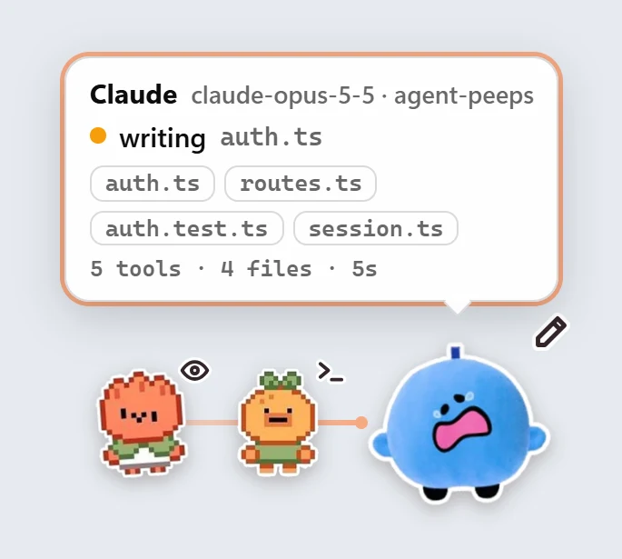 | 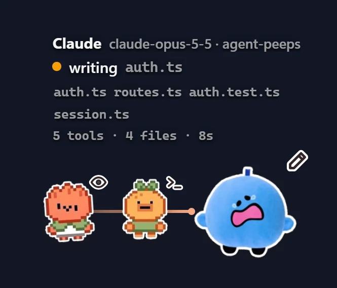 | 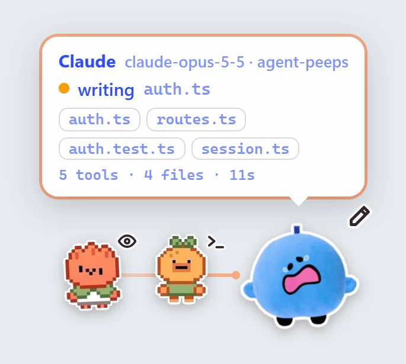 |

## Keyboard shortcuts

Work from anywhere without opening the control room. A toast near the bottom of the screen confirms each one.

`Ctrl+Alt+Shift` (`⌘⌥⇧` on macOS) plus:

| Key | Does | | Key | Does |
|---|---|---|---|---|
| `A` | Show or hide the stickers | | `S` | Next size |
| `C` | Open the control room | | `W` | When to show an agent: while it works, alerts, always |
| `F` | Everywhere / only over my apps | | `L` | Helper layout: line, pod, none |
| `B` | Speech bubbles on or off | | `M` | Motion: lively, calm, off |
| `P` | Peek: open every bubble | | `H` | Hide for 30 minutes |
| `T` | Bubble theme: auto, dark, light | | `R` | Reset positions |
| `D` | Details in the bubble or always | | | |

<p align="center">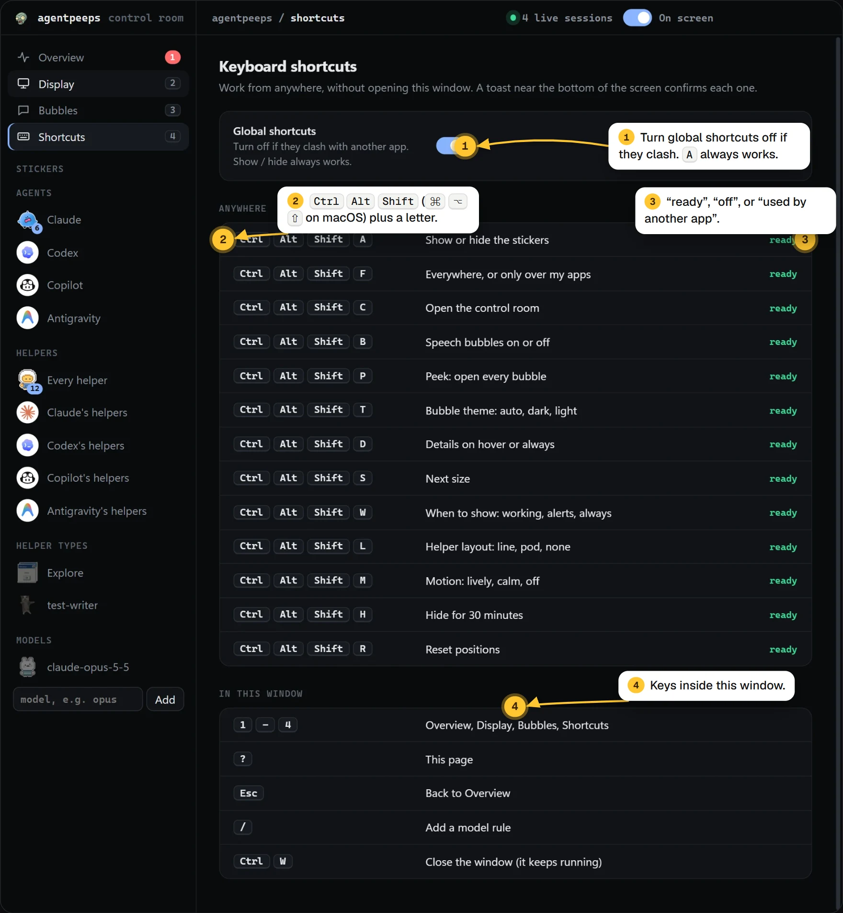</p>

1. **Global shortcuts** switch. Turn them off if they clash with another app; `A` (show / hide) always works.
2. **The combination:** `Ctrl` `Alt` `Shift` (`⌘` `⌥` `⇧` on macOS) plus a letter.
3. **Status:** *ready*, *off*, or *used by another app* (another program registered it first).
4. **Keys inside this window.**

## Stickers

Every target in the sidebar has its own page: an agent, an agent's helpers, every helper, a helper type, or a model rule (type part of a model name, like `opus`, and press **Add**).

<p align="center">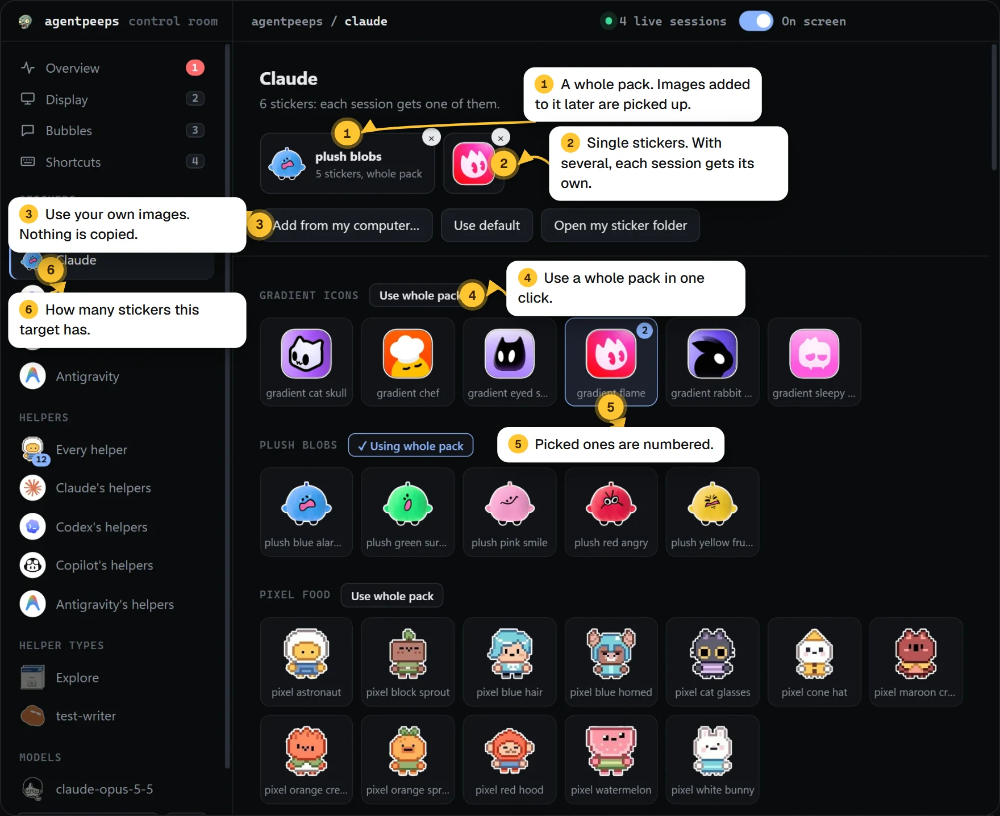</p>

1. **A whole pack.** Images added to its folder later are picked up.
2. **Single stickers.** With several, each session gets its own.
3. **Add from my computer…** uses your own images in place. Nothing is copied. **Use default** goes back to the agent's logo, and **Open my sticker folder** opens `~/.agent-presence/stickers/`.
4. **Use whole pack** in one click.
5. **Picked stickers are numbered** in the order they're handed out.
6. **The count** of stickers each target has.

Until you pick stickers, each agent shows its own logo.

## On the stickers

| Needs you | Details always |
|---|---|
| 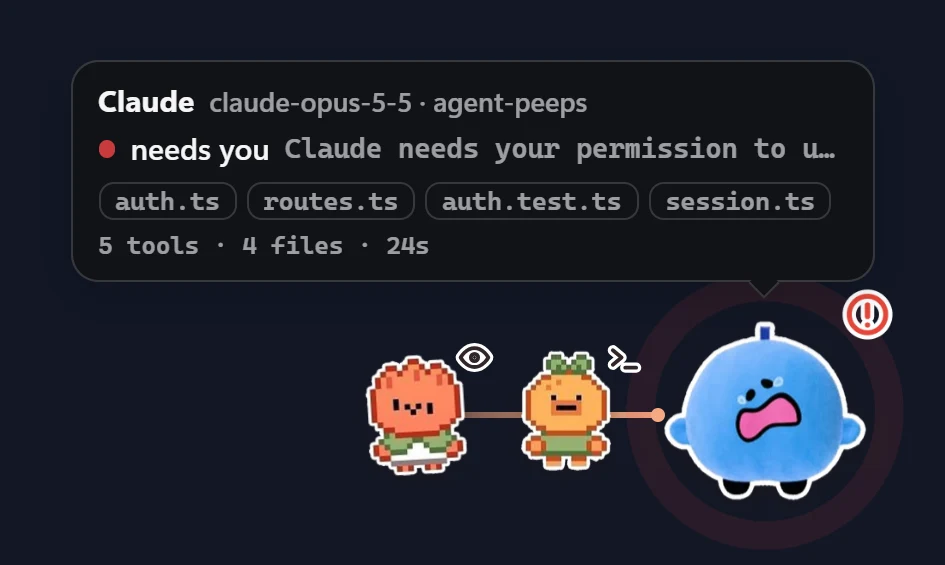 | 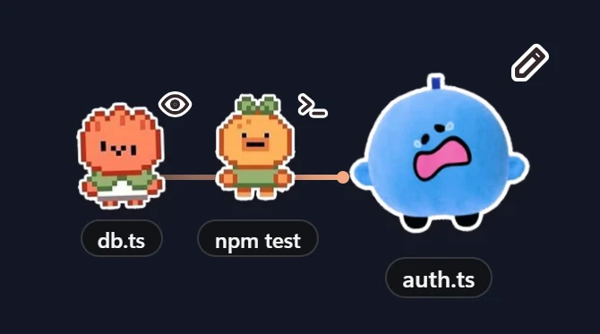 |
| When an agent waits on you, its sticker gets a red ring and the bubble opens by itself. | With details set to *always*, a short line under each sticker says what it's doing. |

- **Hover** for the bubble.
- **Click** to pin the bubble open; click again to unpin.
- **Drag** to put that agent anywhere. Each agent remembers its spot; `Ctrl+Alt+Shift+R` resets them.
- **Right-click** to change or hide just that one, peek at every bubble, hide everything for 30 minutes, or quit.

## Settings file

The control room writes `~/.agent-presence/config.json`. You (or an agent) can edit it by hand too; the overlay applies changes live.

| Key | Values |
|---|---|
| `avatars` | Target → image path, `"pack:<name>"`, or a list of both. `~` is allowed. |
| `names` | Display name per agent, e.g. `{"claude": "Foxy"}`. |
| `size` | `small` (default) · `medium` · `large` |
| `show` | `working` (default) · `alerts` · `always` |
| `details` | `hover` (default) · `always` |
| `agents` | `false` hides an agent; `"subagent": false` hides all helpers. |
| `autostart` | `false` stops the overlay opening on new sessions. Default `true`. |
| `scope` | `everywhere` (default) · `apps`: only while an app in `apps` is in front |
| `apps` | Process names (Windows), app names (macOS) or commands (Linux) that count as yours. Defaults to common editors and terminals. |
| `helpers` | `line` (default) · `pod` · `none` |
| `motion` | `lively` (default) · `calm` · `off` |
| `icon` | `false` hides the small status badge. Default `true`. |
| `opacity` | 30 to 100. Stickers rest at this opacity until you hover them. Default `100`. |
| `shortcuts` | `false` turns off every global shortcut except show / hide. Default `true`. |
| `bubble` | `on`, `border`, `auto` (open when it needs you), `stats`: booleans, all `true` by default · `style`: `card` or `text` · `theme`: `auto`, `dark` or `light` · `text`: `auto` or a color like `#ffd166` · `size`: `small`, `medium` or `large` |

## Troubleshooting

- **A page says "Restart Agent Peeps to finish updating"** (or Bubbles and Shortcuts are empty). The overlay that is running started before you updated, so it doesn't know the new settings yet. Restart it:

  ```bash
  agentpeeps overlay --quit
  ```

  ```bash
  agentpeeps overlay
  ```

- **A shortcut says "used by another app".** Another program registered that combination first. Close it, or turn global shortcuts off.
- **The stickers vanished with "Only over my apps" on.** The app in front isn't in your list. Open Display, find it under **In front now** or among the dashed apps, and click it to add it. On Linux this needs `xdotool` (X11). Where the app in front can't be read, the Display page says so and the stickers show everywhere.
